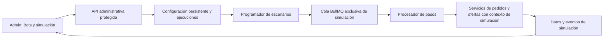

# Plan: 10 clientes bot y 10 trabajadores bot para Chamba

Fecha: 2 de noviembre de 2026. Plan original; la entrega implementada se describe en [bots-simulacion.md](./bots-simulacion.md).

La primera entrega utiliza el esquema PostgreSQL `chamba_simulation`, separado de las tablas reales. Los pasos y sus fechas se procesan con el programador existente y transacciones, sin añadir una cola Redis. Incluye una sola zona circular para todo el grupo y centro manual o automático en el último cliente que actualiza su ubicación. Los apartados siguientes conservan la propuesta inicial; funciones como limpieza de ejecuciones, horarios personalizados y demostración pública quedan para otra entrega.

## Resultado esperado

Un módulo del backend crea y administra veinte actores simulados. Los clientes generan pedidos; trabajadores bot compatibles presentan ofertas y el cliente bot acepta una. El escenario avanza por llegada, confirmación y finalización. Todo funciona sin teléfonos, sin que el admin permanezca abierto y sin una instancia de aplicación por bot.

Los perfiles, pedidos y actividad pertenecen a un modo de simulación identificado. No se presentan como contrataciones de personas reales. El panel los muestra con foto, nombre, rol, oficio, estado y recorrido completo. Si después se habilita una demostración pública, se ofrece como experiencia identificada de demostración, separada de la contratación real.

## Base encontrada en el proyecto

- Backend NestJS con PostgreSQL, Redis, BullMQ y programación de tareas ya instalados.
- Cola y consumidor existentes para distribuir avisos a trabajadores.
- Servicios para crear pedidos, ofertar, aceptar, registrar llegada, confirmar y completar trabajos.
- Panel React con listados, trabajos, mapa y eventos en tiempo real.
- Un `seedData()` heredado de usuarios demo se invoca durante el inicio del módulo móvil. Debe revisarse antes de añadir otro creador automático: el aprovisionamiento de los veinte bots será una operación administrativa explícita e idempotente.

No hace falta un modelo de IA para controlar estos actores. Plantillas y una máquina de estados bastan; los avatares se preparan una vez y se almacenan como recursos.

## Arquitectura propuesta



Crear `BotsModule` dentro del backend existente. Reutilizar los servicios de negocio mediante un contexto interno explícito; el motor no inicia sesión con contraseñas de usuarios ni llama a endpoints públicos para suplantarlos. Mantener las comprobaciones de rol, propiedad, importe, modalidad y estado de cada operación.

La cola propuesta es `chamba-simulation`. No reutilizar ni pausar la cola de avisos reales. El programador periódico genera escenarios y los procesadores ejecutan pasos cortos. Los tiempos entre pasos se representan con trabajos diferidos, no con promesas que mantengan un proceso dormido durante minutos.

## Los veinte perfiles

Crear `CLIENT-01` a `CLIENT-10` y `WORKER-01` a `WORKER-10`, con nombres ficticios y una etiqueta de simulación.

Cada perfil conserva:

- Identificador estable y relación con su usuario de simulación.
- Rol, nombre, avatar y estado habilitado/deshabilitado.
- Zona de prueba, ubicación aproximada y oficio o tipos de solicitudes.
- Modalidades, tarifas y disponibilidad simulada del trabajador.
- Escenario activo, última acción, próxima acción y último error.
- Contadores exclusivos de simulación, con enlace a su historial.

Distribución inicial propuesta de trabajadores: tres de limpieza, tres de plomería, dos de electricidad y dos de pintura. Los clientes generan exclusivamente solicitudes cubiertas por este catálogo. La distribución es editable desde el admin.

Usar avatares ilustrados o retratos sintéticos identificados como tales. No usar fotos de personas para atribuirles identidades ficticias. Los bots no necesitan CI ni contactos de personas reales; bloquear correo, SMS, recuperación de contraseña y otros envíos externos para estos actores. No crear un atajo de verificación que pueda utilizar una cuenta real.

## Datos propuestos

| Registro | Información principal |
| --- | --- |
| `bot_settings` | Estado deseado, versión de control, intervalos, horario, límites y configuración |
| `bot_profiles` | Actor, usuario asociado, rol, avatar, reglas y estado individual |
| `bot_runs` | Inicio, fin, administrador, estado y copia de la configuración aplicada |
| `bot_scenarios` | Cliente, trabajador reservado, pedido, paso actual, próxima ejecución y resultado |
| `bot_actions` | Acción, identificador idempotente, fecha, resultado, error e intento |

Los usuarios, pedidos, ofertas y demás registros de dominio que participen deben llevar un alcance persistente de simulación y su ejecución de origen. El alcance se fija por código interno antes de insertar y antes de emitir eventos; no se acepta desde el cuerpo de una petición pública.

La elección de convivir en las tablas actuales exige revisar todas las lecturas y efectos secundarios. Si no se puede acreditar ese aislamiento, la primera entrega debe operar con una base de simulación separada. No se habilita actividad mezclada con usuarios reales como atajo.

## Cómo conseguir que siempre lo tome un bot

1. El programador elige un cliente bot libre.
2. Selecciona categoría, zona y presupuesto de una plantilla válida.
3. Reserva mediante transacción un trabajador bot libre compatible con oficio, modalidad y distancia.
4. Solo entonces crea el pedido, ya marcado como simulado.
5. Se programa la oferta del trabajador reservado, y después la aceptación del cliente.
6. Si ese trabajador falla, se libera la reserva y se intenta con otro bot compatible, con un límite de reintentos.

Si no hay trabajadores bot disponibles, el cliente espera. No se publica un pedido sin cobertura. Un trabajador real no recibe ni puede aceptar pedidos simulados; un bot no puede tomar un pedido real. La exclusividad se valida en el servidor y en la transacción de aceptación, no solo ocultando botones.

Esto garantiza la regla de elegibilidad. No significa prometer que un escenario jamás pueda fallar: los fallos de infraestructura se registran, reintentan o dejan el escenario detenido de forma visible.

## Recorrido automático

Estado inicial → pedido creado → oferta presentada → oferta aceptada → trabajador en camino → llegada → confirmación del cliente → trabajo terminado → cierre simulado.

Estos nombres describen el escenario del motor; se mapearán a los estados que ya usa el dominio, sin introducir estados incompatibles para las apps existentes.

Por ejemplo: `CLIENT-03` solicita una reparación, `WORKER-07` oferta, el cliente acepta y ambos completan las acciones previstas. El admin puede seguir cada paso y abrir el pedido correspondiente.

Para el lanzamiento en efectivo, el cierre es una simulación de las declaraciones de ambas partes. No se registra un cobro bancario, no se inicia un checkout ni se genera una obligación de pago real. Las reseñas, si se prueban, quedan dentro del alcance simulado y no mejoran la reputación pública.

## Controles del admin

Añadir una sección **Bots y simulación** con:

- Resumen: diez clientes, diez trabajadores, habilitados, ocupados, escenarios en curso, terminados y con error.
- Interruptor global y estado observado: apagado, iniciando, activo, pausando o detenido.
- Botones: crear/restaurar los veinte perfiles, ejecutar un escenario, iniciar, pausar, detener y limpiar una ejecución de prueba seleccionada.
- Configuración: horario de Bolivia, frecuencia, categorías, zonas, presupuesto simulado y máximo de actividad.
- Listado con foto, nombre, rol, oficio, estado, último movimiento y contadores simulados.
- Ficha del bot: perfil editable, actividad, pedidos, contrapartes y fallos.
- Tabla de escenarios: cliente, trabajador, pedido, paso y duración.
- Registro de acciones en tiempo real; una recarga del panel recupera el estado desde el servidor.

El navegador solo consulta y envía comandos. Cerrar el panel no detiene los bots. Las acciones de control registran qué administrador las solicitó.

## Encendido, pausa y apagado

**Encender:** validar que hay veinte perfiles, almacenamiento y cola disponibles; abrir una ejecución, guardar la configuración y activar el programador. Repetir el comando no crea otro grupo de veinte ni otro programador.

**Pausar:** dejar de crear escenarios nuevos y permitir que terminen los ya iniciados. Mostrar cuántos faltan antes de declarar la pausa completa.

**Detener:** persistir el estado deshabilitado e incrementar la versión de control. Retirar el programador y cancelar pasos pendientes de esa ejecución. Cada procesador comprueba el estado y la versión antes de confirmar una acción. Serializar esa comprobación y la escritura con el control de apagado para que no aparezcan acciones nuevas después de confirmar la detención. Una acción ya confirmada no se deshace automáticamente.

Pausar una cola no basta para detener un trabajo que ya está ejecutándose. Por eso se necesita control persistente y cancelación cooperativa por pasos. [Comportamiento de pausa de BullMQ](https://docs.bullmq.io/guide/workers/pausing-queues).

**Reinicio del backend:** recuperar configuraciones y pasos persistidos. Respetar el estado guardado; nunca activar el sistema solo porque el proceso arrancó. Usar bloqueos y restricciones únicas para que dos réplicas no creen la misma acción.

## Endpoints administrativos propuestos

Todos con autenticación y rol de administrador; no son endpoints existentes todavía.

```text
GET   /admin/bots/status
GET   /admin/bots
GET   /admin/bots/:id
PATCH /admin/bots/:id
GET   /admin/bots/scenarios
GET   /admin/bots/runs/:runId/actions
PATCH /admin/bots/settings
POST  /admin/bots/provision
POST  /admin/bots/start
POST  /admin/bots/pause
POST  /admin/bots/stop
POST  /admin/bots/run-once
POST  /admin/bots/runs/:runId/cleanup
```

Los comandos de mutación requieren identificadores idempotentes. La limpieza está limitada a registros vinculados a la ejecución elegida; exige comprobar que no hay pasos activos y nunca toca datos sin marca de simulación.

## Separación de la operación real

Auditar listados, mapa, radar, matching, autenticación, notificaciones, mensajería, historiales, reportes, reseñas, pagos, comisiones y páginas públicas. Las consultas y los eventos deben respetar el alcance en el servidor.

Los bots no aparecen en resultados reales, no notifican a personas, no contactan teléfonos, no generan cobros o transferencias y no aumentan ingresos, usuarios activos o servicios reales completados. En el admin, permitir filtrar actividad real y simulada y mostrar sus cifras por separado.

Los eventos de prueba se publican en salas exclusivas de simulación, disponibles únicamente para administradores y, si se incorpora, el modo explícito de demostración. Ningún evento debe emitirse al canal global real antes de verificar su alcance.

## Configuración inicial sugerida

- Sistema apagado por defecto.
- Veinte perfiles persistentes: diez por rol.
- Un escenario nuevo cada diez minutos dentro del horario configurado.
- Hasta tres escenarios simultáneos y treinta por día.
- Oferta en unos segundos y duración de prueba de unos minutos, rotuladas como tiempos de simulación.
- Plantillas y categorías precargadas para evitar llamadas de IA o cargas de imágenes por cada escenario.
- Una prueba manual completa disponible antes de activar el modo continuo.

Son límites iniciales editables, no una predicción de consumo. Medir consultas, crecimiento de tablas y uso de Redis durante una ejecución corta antes de ampliar el ritmo.

## Entregas y comprobaciones

1. **Aislamiento y persistencia.** Migraciones, actores, control administrativo y restricciones de alcance. Verificar que aprovisionar dos veces conserva exactamente veinte bots.
2. **Un escenario completo.** Crear, ofertar, aceptar, llegar y terminar usando las reglas del dominio. Probar que un usuario real no entra en el circuito en ninguna dirección.
3. **Motor continuo.** Programación, reservas, límites, reintentos y recuperación. Repetir trabajos y reiniciar dos réplicas sin duplicar pedidos, ofertas ni cierres.
4. **Panel y operación.** Perfiles con fotos, historial, estados, controles y acciones. Probar apagado con pasos activos y diferidos, independencia del navegador y ausencia de efectos financieros o notificaciones reales.

Criterio de aceptación: el administrador puede seguir una ejecución de principio a fin, pausarla, detenerla y consultar sus veinte perfiles; la operación real permanece independiente y los escenarios soportan reinicios sin repetirse.

Referencia técnica adicional: [gestión de programadores BullMQ](https://docs.bullmq.io/guide/job-schedulers/manage-job-schedulers). Confirmar las firmas con la versión instalada del proyecto antes de implementar; no actualizar dependencias solo para añadir el simulador.
